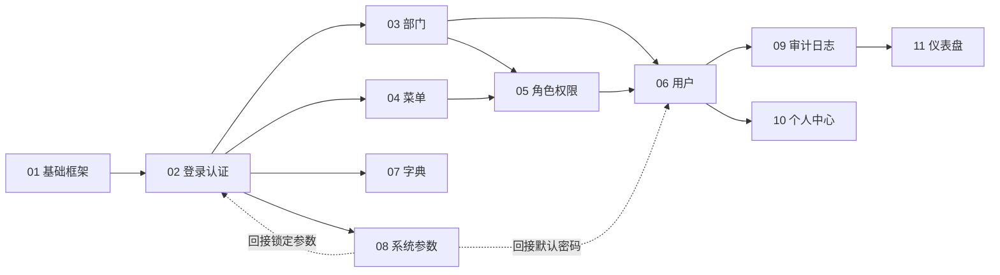

# 后台管理系统 - 需求总览

> 来源：[PRD.md](../../PRD.md) v1.0（2026-10-29）

## PRD 摘要
为公司内部多个业务线提供统一的后台管理系统，解决权限混乱、离职账号没有及时回收、操作无法追溯等问题。核心能力：统一账号与基于角色的权限控制（细到按钮）、按部门的数据范围、登录与关键操作审计、通过界面维护菜单/字典/参数。

**用户角色**：超级管理员（内置，不可删除或禁用）、系统管理员、部门管理员（本部门及下级）、普通员工（只能访问被授权的菜单，并维护自己的信息）。

## 全局约束
| 类别 | 要求 |
| --- | --- |
| 性能 | 10 万条数据下列表接口 P95 < 500ms；首页首屏 < 2s |
| 安全 | bcrypt 存储密码；HTTPS；防 SQL 注入和 XSS；列表中手机号和邮箱脱敏 |
| 兼容性 | Chrome/Edge/Firefox/Safari 最新两个版本；最小分辨率 1366×768 |
| 可用性 | 写操作都提示结果；删除前二次确认 |
| 国际化 | 一期只做中文，文案抽取为资源 |
| 技术栈 | Vue 3 + TS + Element Plus + Vite；NestJS + MySQL 8 + Redis；JWT 双令牌 |

**一期范围外**：SSO 和第三方登录、多租户、工作流与审批、移动端适配。

## 全局约定（详见 01-project-scaffold）
- 响应格式 `{ code, message, data }`，分页 `{ list, total, page, pageSize }`
- 错误码为 5 位：前三位沿用 HTTP 语义，后两位由模块自定义
- 权限标识格式 `模块:资源:动作`，如 `system:user:add`

## 需求索引
| 序号 | 需求 | 里程碑 | PRD 章节 | 依赖 | 任务数（父/子） |
| --- | --- | --- | --- | --- | --- |
| 01 | [项目基础框架](../01-project-scaffold/) | M1 | §4、§5 | — | 8 / 15 |
| 02 | [登录与认证](../02-auth/) | M1 | §3.1 | 01 | 8 / 21 |
| 03 | [部门管理](../03-department/) | M1 | §3.5 | 02 | 7 / 9 |
| 04 | [菜单管理](../04-menu/) | M1 | §3.4 | 02 | 7 / 13 |
| 05 | [角色与权限](../05-role-permission/) | M1 | §3.3 | 03、04 | 9 / 15 |
| 06 | [用户管理](../06-user/) | M1 | §3.2 | 03、05 | 8 / 20 |
| 07 | [数据字典](../07-dict/) | M2 | §3.6 | 02 | 7 / 9 |
| 08 | [系统参数配置](../08-system-config/) | M2 | §3.8 | 02 | 6 / 8 |
| 09 | [操作日志与登录日志](../09-audit-log/) | M2 | §3.7 | 02、06 | 8 / 11 |
| 10 | [个人中心](../10-profile/) | M3 | §3.10 | 02、06 | 4 / 10 |
| 11 | [首页仪表盘](../11-dashboard/) | M3 | §3.9 | 09 | 4 / 11 |

## 依赖关系

虚线表示"后完成的模块回头接入已有模块"：02 和 06 先用默认值实现，08 完成后改为读取系统参数。

## 汇总：待确认问题
| 需求 | 问题 | 当前假设 |
| --- | --- | --- |
| 01 | ORM 和仓库组织方式 | TypeORM；单仓库下 `server/` + `web/` |
| 02 | 失败锁定是否还需要按 IP 限流 | 只按账号锁定 |
| 02 | 刷新令牌是否轮换 | 每次刷新都轮换 |
| 02 | 超级管理员初始密码如何下发 | 环境变量 `ADMIN_INIT_PASSWORD`，首次登录强制改密 |
| 03 | 负责人是否关联系统用户 | 自由文本 |
| 05 | "仅本人"数据范围的判断依据 | 用户管理中只能看到自己；其他表按 `created_by` |
| 06 | 导入是否允许部分成功 | 全部成功或全部失败 |
| 06 | 导入行数上限、导出是否脱敏 | 1000 行；导出同样脱敏 |
| 07 | 前端字典缓存的失效策略 | 刷新页面后重新获取 |
| 08 | 默认密码是否在界面上掩码显示 | 掩码显示，编辑时可查看 |
| 09 | 日志保留天数是否可配置 | 固定 180 天 |
| 09 | 退出登录是否记入登录日志 | 不记录 |
| 10 | 头像存储位置 | 服务器本地 `uploads/avatar/`，预留对象存储扩展 |
| 11 | 统计数据是否受数据范围限制 | 展示全局数据，只对有 `dashboard:view` 权限的角色开放 |

## 开发方式
使用 `/ewb:task-dev specs/<需求文件夹>` 按 tasks.md 逐项开发，每完成一项把 `- [ ]` 改为 `- [✅]`。建议按序号顺序推进。
