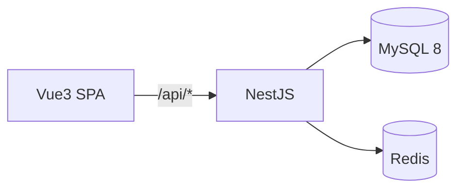

# 项目基础框架 - 技术设计

## 概述
单仓库包含 `server/`（NestJS）与 `web/`（Vue 3）。后端提供全局响应拦截器、异常过滤器、参数校验管道和分页 DTO；前端提供 axios 封装、基础布局、i18n 与通用组件。

## 架构 / 流程


目录结构（假设）：
```
server/src/
  main.ts
  app.module.ts
  config/            # 按环境的配置（.env + @nestjs/config）
  common/
    interceptors/transform.interceptor.ts
    filters/http-exception.filter.ts
    exceptions/biz.exception.ts
    dto/page-query.dto.ts
    entities/base.entity.ts
  modules/health/
web/src/
  api/request.ts
  layout/            # Sidebar / Header / Breadcrumb
  router/
  stores/
  locales/zh-CN.ts
  components/
```

## 数据模型
公共基础实体 `BaseEntity`（各业务表继承）：

| 字段 | 类型 | 说明 |
| --- | --- | --- |
| id | bigint PK 自增 | 主键 |
| created_at | datetime | 创建时间 |
| updated_at | datetime | 更新时间 |
| created_by | bigint null | 创建人 ID |
| updated_by | bigint null | 更新人 ID |
| deleted_at | datetime null | 逻辑删除时间（需要逻辑删除的表使用） |

## 接口设计
| 方法 | 路径 | 说明 |
| --- | --- | --- |
| GET | /api/health | 返回 `{ db: "up"|"down", redis: "up"|"down" }` |

统一响应：
```json
{ "code": 0, "message": "ok", "data": {} }
```
分页响应 `data`：
```json
{ "list": [], "total": 0, "page": 1, "pageSize": 10 }
```

错误码约定（全局）：

| code | HTTP | 含义 |
| --- | --- | --- |
| 0 | 200 | 成功 |
| 40000 | 400 | 参数错误 |
| 40100 | 401 | 未登录 / 令牌无效 |
| 40300 | 403 | 无权限 |
| 40400 | 404 | 资源不存在 |
| 40900 | 409 | 数据冲突（唯一键重复等） |
| 50000 | 500 | 服务器内部错误 |

各业务模块错误码使用 5 位，前三位沿用 HTTP 语义，后两位模块内自定义（如 40901 账号已存在）。

## 前端 / 交互
- `request.ts`：axios 实例，baseURL `/api`；请求拦截器注入 `Authorization`（由 02-auth 填充）；响应拦截器对非 0 code 调用 `ElMessage.error(message)` 并 reject。
- 布局：左侧 `Sidebar`（菜单数据由 04-menu 提供，本阶段用静态占位）、顶部 `Header`（面包屑 + 用户下拉）、`AppMain`（`<router-view>` + keep-alive）。
- 通用组件：`ConfirmButton`（删除二次确认）、`SearchTable`（筛选 + 表格 + 分页的组合骨架）。
- i18n：vue-i18n，`locales/zh-CN.ts` 集中文案。

## 异常处理
- `BizException(code, message)` 由业务抛出，过滤器转换为统一响应。
- class-validator 校验失败转换为 40000，并在 message 中列出首个失败字段。
- 未知异常记录服务端错误日志，响应只返回"服务器内部错误"。

## 测试策略
- 单测：响应拦截器、异常过滤器、分页 DTO 校验（pageSize > 100 被拒绝）。
- e2e：`GET /api/health` 返回 200。
- 前端：`request.ts` 对非 0 code 的处理。
