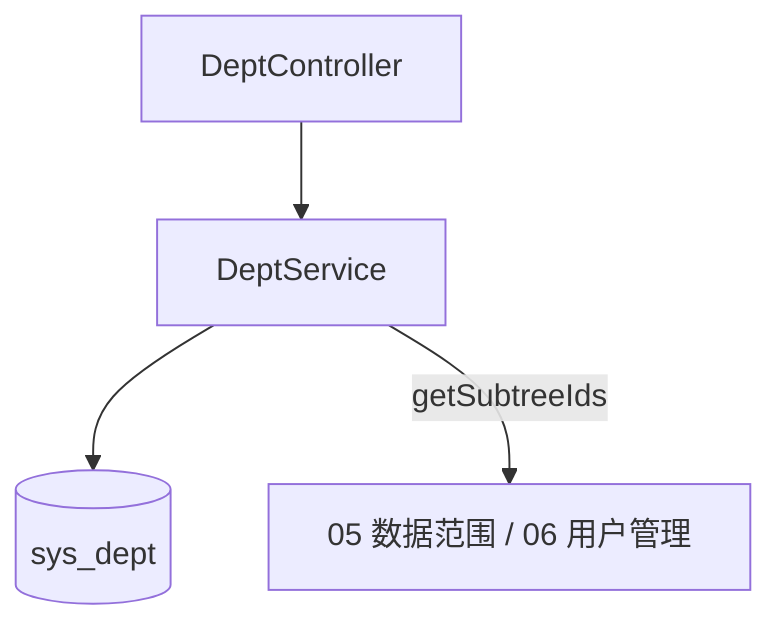

# 部门管理 - 技术设计

## 概述
`DeptModule` 提供部门树的增删改查。使用 `ancestors` 字段（祖先 ID 路径）实现子树查询，避免递归 SQL。

## 架构 / 流程

## 数据模型
`sys_dept`（继承 BaseEntity）：

| 字段 | 类型 | 说明 |
| --- | --- | --- |
| parent_id | bigint default 0 | 0 表示根 |
| ancestors | varchar(500) | 祖先路径，如 `0,1,5` |
| name | varchar(50) | 部门名称 |
| leader | varchar(32) null | 负责人（假设为文本） |
| phone | varchar(20) null | 联系电话 |
| sort | int default 0 | 排序号 |
| status | tinyint | 1 启用 / 0 停用 |

索引：`(parent_id, name)` 唯一；`ancestors` 前缀查询使用 `LIKE '0,1,5%'`。

## 接口设计
| 方法 | 路径 | 权限标识 | 说明 |
| --- | --- | --- | --- |
| GET | /api/depts | system:dept:list | 查询树，参数 `name`、`status` |
| GET | /api/depts/options | 登录即可 | 启用部门精简树 `{ id, name, children }` |
| GET | /api/depts/:id | system:dept:query | 详情 |
| POST | /api/depts | system:dept:add | 新增 |
| PUT | /api/depts/:id | system:dept:edit | 编辑 |
| DELETE | /api/depts/:id | system:dept:remove | 删除 |

错误码：40901 同级名称重复；40902 父级不能是自身或下级；40903 存在子部门；40904 部门下存在用户；40905 下级存在启用部门，不能停用。

`DeptService.getSubtreeIds(deptId): Promise<number[]>` 供其他模块调用。

## 前端 / 交互
- `views/system/dept/index.vue`：树形表格（默认展开），顶部按名称、状态筛选；行内操作"新增下级 / 编辑 / 删除"。
- 新增/编辑弹窗：父级使用 `el-tree-select`，编辑时禁用自身及下级节点。
- 部门下拉组件 `DeptTreeSelect` 抽出复用（06 使用）。

## 异常处理
- 修改父级时在事务中批量更新子树 `ancestors`（`REPLACE(ancestors, 旧前缀, 新前缀)`）。
- 删除前的两项校验与删除放在同一事务中。

## 测试策略
- 单测：树构建、筛选保留祖先、父级循环校验、ancestors 更新。
- e2e：有子部门或有用户时删除失败；正常删除成功。
