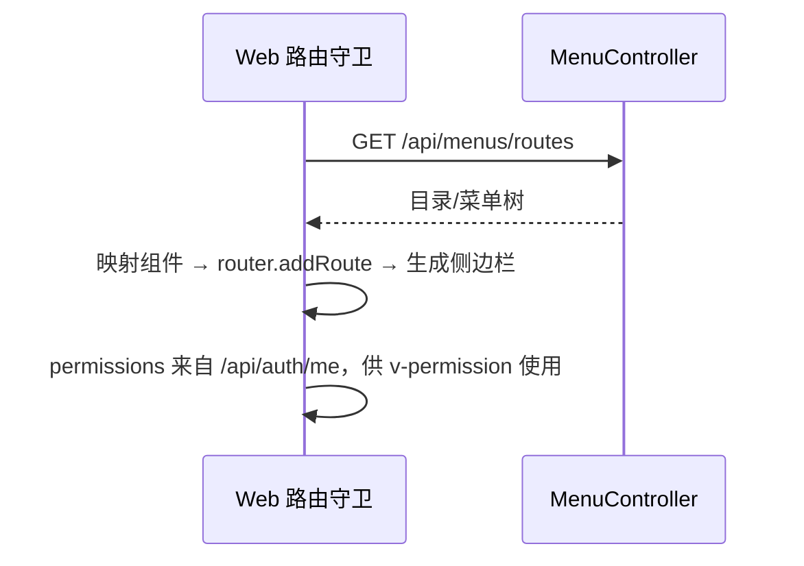

# 菜单管理 - 技术设计

## 概述
`MenuModule` 维护 `sys_menu` 树，并提供"当前用户路由"接口。前端在登录后拉取路由数据，把 `component` 字符串映射为 `import.meta.glob` 收集到的视图组件，动态注册路由。

## 架构 / 流程


## 数据模型
`sys_menu`（继承 BaseEntity）：

| 字段 | 类型 | 说明 |
| --- | --- | --- |
| parent_id | bigint default 0 | 父级 |
| name | varchar(50) | 名称 |
| type | char(1) | `M` 目录 / `C` 菜单 / `F` 按钮 |
| path | varchar(200) null | 路由路径 |
| component | varchar(255) null | 组件路径，如 `system/user/index` |
| icon | varchar(100) null | 图标名 |
| sort | int default 0 | 排序号 |
| perms | varchar(100) null unique | 权限标识 |
| visible | tinyint default 1 | 是否在侧边栏显示 |
| status | tinyint default 1 | 1 启用 / 0 停用 |

角色关联表 `sys_role_menu` 由 05-role-permission 建立；本模块删除菜单时调用其清理方法（05 未完成前先预留）。

## 接口设计
| 方法 | 路径 | 权限标识 | 说明 |
| --- | --- | --- | --- |
| GET | /api/menus | system:menu:list | 菜单树，参数 `name`、`status` |
| GET | /api/menus/options | 登录即可 | 精简树（用于父级选择、角色授权） |
| GET | /api/menus/:id | system:menu:query | 详情 |
| POST | /api/menus | system:menu:add | 新增 |
| PUT | /api/menus/:id | system:menu:edit | 编辑 |
| DELETE | /api/menus/:id | system:menu:remove | 删除 |
| GET | /api/menus/routes | 登录即可 | 当前用户路由树 |

路由节点结构：
```json
{ "path": "/system", "component": "Layout", "name": "System",
  "meta": { "title": "系统管理", "icon": "setting", "hidden": false },
  "children": [ { "path": "user", "component": "system/user/index", "name": "SystemUser", "meta": { "title": "用户管理" } } ] }
```

错误码：40002 字段与类型不匹配；40906 权限标识重复；40907 存在子菜单，不允许删除。

## 前端 / 交互
- `views/system/menu/index.vue`：树形表格；表单根据类型动态显示字段；图标选择器 `IconSelect`。
- `router/dynamic.ts`：`const modules = import.meta.glob('../views/**/*.vue')`，把 `component` 映射为懒加载组件，找不到时回退到 404 组件并在控制台告警。
- `stores/permission.ts`：保存路由与侧边栏数据；退出登录时重置路由。
- `directives/permission.ts`：`v-permission="'system:user:add'"`，支持数组（任一满足即显示）；超级管理员拥有 `*:*:*`。

## 异常处理
- 路由守卫中拉取路由失败时提示错误并退回登录页。
- 种子数据使用固定的权限标识，重复执行种子脚本时幂等（按 perms 或 path 判断是否已存在）。

## 测试策略
- 单测：按类型的字段校验、权限标识格式校验、路由树构建（过滤按钮和停用节点）。
- 前端：组件映射与回退；`v-permission` 指令显示与隐藏。
- e2e：删除有子节点的菜单失败。
