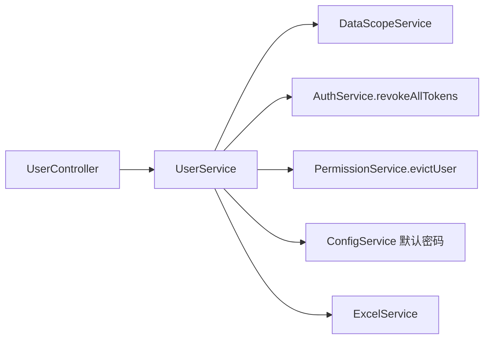

# 用户管理 - 技术设计

## 概述
在 02-auth 建立的 `sys_user` 表基础上实现 `UserModule` 的管理接口。查询统一经过 `DataScopeService`；会影响登录态的操作调用 `AuthService.revokeAllTokens`；会影响权限的操作调用 `PermissionService.evictUser`。导入导出使用 exceljs。

## 架构 / 流程

## 数据模型
沿用 `sys_user`（见 02-auth/design.md），补充索引：

| 索引 | 字段 |
| --- | --- |
| idx_user_dept | dept_id, deleted_at |
| idx_user_status | status, deleted_at |
| idx_user_phone | phone |
| idx_user_real_name | real_name |

账号唯一约束对已逻辑删除的记录同样生效（不放开唯一索引）。

用户与角色的关联使用 05 建立的 `sys_user_role`。

## 接口设计
| 方法 | 路径 | 权限标识 | 说明 |
| --- | --- | --- | --- |
| GET | /api/users | system:user:list | 分页列表，参数 `username`、`realName`、`phone`、`deptId`、`status` |
| GET | /api/users/:id | system:user:query | 详情（含 `roleIds`，手机号和邮箱不脱敏） |
| POST | /api/users | system:user:add | 新增 |
| PUT | /api/users/:id | system:user:edit | 编辑（忽略 username） |
| PUT | /api/users/:id/status | system:user:edit | `{ status }` |
| PUT | /api/users/:id/password/reset | system:user:resetPwd | 重置为默认密码 |
| DELETE | /api/users/:id | system:user:remove | 逻辑删除 |
| GET | /api/users/import/template | system:user:import | 下载模板 |
| POST | /api/users/import | system:user:import | multipart 上传 `file`，返回 `{ success: n }` 或 `{ errors: [{ row, message }] }` |
| GET | /api/users/export | system:user:export | 按筛选条件导出 xlsx |

错误码：40910 账号已存在；40303 不能操作内置超级管理员；40304 不能禁用或删除自己；40305 目标不在数据范围内；40003 导入文件格式错误或超过 1000 行；40004 导入校验失败（`data.errors` 中给出明细）。

所有按 ID 操作的接口都先确认目标用户在当前操作人的数据范围内。

脱敏工具 `mask.ts`：手机号保留前 3 位和后 4 位；邮箱保留首字符和域名。

## 前端 / 交互
- `views/system/user/index.vue`：左侧部门树（点击后按部门筛选，含下级），右侧筛选栏 + 表格 + 分页。
- 工具栏：新增、导入、导出（分别使用 `v-permission` 控制）。
- 行操作：编辑、重置密码（确认框）、删除（确认框）、状态开关（禁用时二次确认，并提示"该用户将被强制下线"）。
- 编辑弹窗：使用 `DeptTreeSelect` 和角色多选（`/api/roles/options`）；编辑时账号字段只读。
- 导入弹窗：下载模板 → 拖拽上传 → 展示失败行明细表。

## 异常处理
- 导入时先在内存中整体校验，再在单个事务中批量插入；校验时检查文件内账号是否重复。
- 修改用户角色在事务中完成，事务提交后再清除缓存。
- 导出使用流式写入，避免大数据量时内存过高。

## 测试策略
- 单测：脱敏函数；导入校验（各种错误行）；数据范围外的目标被拒绝。
- e2e：禁用用户后其令牌立即失效（401）；重置密码后登录需改密；不能删除超级管理员或自己；部门管理员只能看到本部门及下级的用户。
- 性能：构造 10 万条用户数据，验证列表接口 P95。
