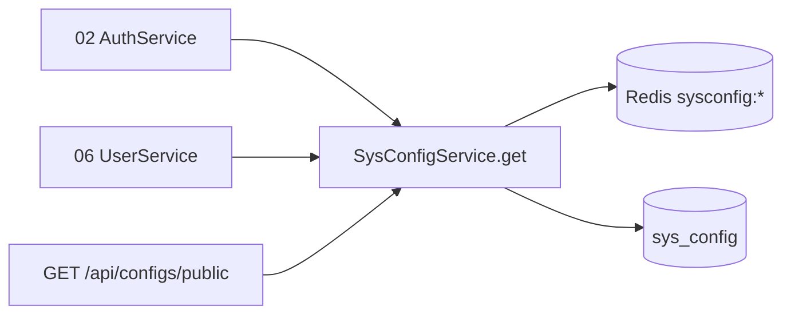

# 系统参数配置 - 技术设计

## 概述
`SysConfigModule` 提供参数维护接口和 `ConfigService.get(key)`。参数缓存在 Redis 中（`sysconfig:{key}`），写操作后清除缓存；内置参数的值校验通过注册表集中定义。

## 架构 / 流程


## 数据模型
`sys_config`（继承 BaseEntity）：

| 字段 | 类型 | 说明 |
| --- | --- | --- |
| name | varchar(100) | 参数名称 |
| config_key | varchar(100) unique | 参数键 |
| config_value | varchar(500) | 参数值 |
| is_builtin | tinyint | 1 内置 |
| remark | varchar(255) null | 备注 |

内置参数校验注册表（代码中定义）：
```ts
const BUILTIN_VALIDATORS = {
  'login.maxFailCount': positiveInt,
  'login.lockMinutes': positiveInt,
  'user.defaultPassword': passwordRule, // 复用 02-auth 的密码规则
};
```

## 接口设计
| 方法 | 路径 | 权限标识 | 说明 |
| --- | --- | --- | --- |
| GET | /api/configs | system:config:list | 分页 |
| GET | /api/configs/:id | system:config:query | 详情 |
| POST | /api/configs | system:config:add | 新增 |
| PUT | /api/configs/:id | system:config:edit | 编辑（内置参数忽略 name 和 key 的修改） |
| DELETE | /api/configs/:id | system:config:remove | 删除（内置参数拒绝） |
| GET | /api/configs/public | Public | 返回 `{ "sys.name", "sys.logo" }` |

错误码：40913 参数键重复；40306 内置参数不能删除；40005 参数值格式不正确。

`SysConfigService`：
- `get(key): Promise<string | undefined>`、`getNumber(key, fallback)`
- 缓存未命中时查库并回写缓存；Redis 不可用时直接查库。

## 前端 / 交互
- `views/system/config/index.vue`：分页表格，内置参数显示"内置"标签且没有删除按钮；`user.defaultPassword` 的值以掩码显示，编辑时可查看。
- 登录页和顶栏通过 `/api/configs/public` 显示系统名称和 Logo。

## 异常处理
- 修改内置参数的值前先经过校验注册表。
- 02 和 06 读取参数失败时回退到代码默认值，并记录告警。

## 测试策略
- 单测：内置参数保护、值校验、缓存失效。
- e2e：把 `login.maxFailCount` 改为 3 后，第 3 次失败即锁定；修改默认密码后新建用户使用新密码。
