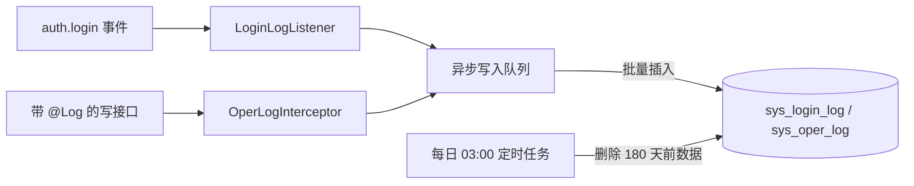

# 操作日志与登录日志 - 技术设计

## 概述
`AuditLogModule` 订阅 `auth.login` 事件写登录日志；通过 `@Log(module, type)` 装饰器和全局 `OperLogInterceptor` 采集操作日志。写入通过内存队列异步批量落库，定时任务每天清理过期数据。

## 架构 / 流程

## 数据模型
`sys_login_log`：

| 字段 | 类型 | 说明 |
| --- | --- | --- |
| id | bigint PK | |
| username | varchar(32) | 账号 |
| ip | varchar(64) | IP |
| browser | varchar(50) | 浏览器 |
| os | varchar(50) | 操作系统 |
| success | tinyint | 1 成功 / 0 失败 |
| message | varchar(255) null | 失败原因 |
| login_at | datetime | 时间（索引） |

`sys_oper_log`：

| 字段 | 类型 | 说明 |
| --- | --- | --- |
| id | bigint PK | |
| module | varchar(50) | 模块 |
| oper_type | varchar(20) | ADD / UPDATE / DELETE / IMPORT / EXPORT / OTHER |
| method | varchar(10) | HTTP 方法 |
| url | varchar(255) | 请求地址 |
| params | text | 脱敏并截断后的参数 |
| success | tinyint | 结果 |
| error_msg | varchar(1000) null | 错误信息 |
| duration_ms | int | 耗时 |
| oper_user_id | bigint null | 操作人 ID |
| oper_username | varchar(32) | 操作人账号 |
| ip | varchar(64) | IP |
| oper_at | datetime | 时间（索引） |

索引：`(oper_at)`、`(oper_username, oper_at)`；`(login_at)`、`(username, login_at)`。

脱敏字段名单（不区分大小写，递归处理对象）：`password`、`oldPassword`、`newPassword`、`token`、`accessToken`、`refreshToken` → `******`；`phone`、`email` → 复用 06 的 `mask.ts`。

UA 解析使用 ua-parser-js；IP 取 `X-Forwarded-For` 的第一个值（需在代理层可信配置，假设）。

## 接口设计
| 方法 | 路径 | 权限标识 | 说明 |
| --- | --- | --- | --- |
| GET | /api/logs/login | monitor:loginlog:list | 分页，参数 `username`、`success`、`startTime`、`endTime` |
| GET | /api/logs/login/export | monitor:loginlog:export | 导出 |
| GET | /api/logs/oper | monitor:operlog:list | 分页，参数 `operUsername`、`module`、`operType`、`success`、`startTime`、`endTime` |
| GET | /api/logs/oper/:id | monitor:operlog:query | 详情 |
| GET | /api/logs/oper/export | monitor:operlog:export | 导出 |

没有修改和删除接口。为 02–08 已有的写接口补充 `@Log` 声明。

## 前端 / 交互
- `views/monitor/login-log/index.vue`、`views/monitor/oper-log/index.vue`：筛选栏（日期范围默认最近 7 天）+ 表格 + 分页 + 导出按钮。
- 操作日志详情抽屉：格式化展示 JSON 参数与错误信息。
- 种子数据中新增"系统监控"目录及两个菜单（在 04 的种子脚本中补充）。

## 异常处理
- 队列每 1 秒或累计 100 条时批量写入；写入失败重试 1 次后丢弃并记录错误日志，不抛到业务层。
- 应用关闭时（`onApplicationShutdown`）先把队列中剩余的日志写完。
- 清理任务分批删除（每批 5000 条），避免长事务锁表。

## 测试策略
- 单测：脱敏（嵌套对象和数组）、参数截断、UA 解析。
- e2e：修改用户后能查到对应的操作日志，且其中密码被脱敏；登录失败能查到登录日志及原因。
- 清理任务：插入 181 天前的数据，执行任务后被删除，179 天前的数据保留。
