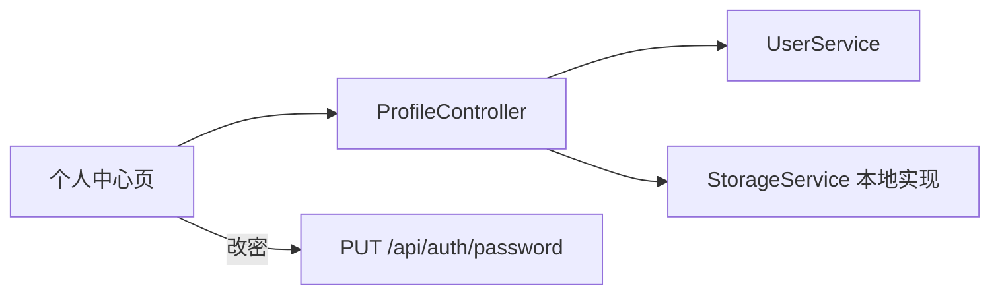

# 个人中心 - 技术设计

## 概述
`ProfileModule` 只操作当前登录用户（从令牌中获取 userId），不需要额外的权限标识。头像上传通过 `StorageService` 抽象，一期使用本地磁盘实现。

## 架构 / 流程

## 数据模型
沿用 `sys_user` 的 `real_name`、`phone`、`email`、`avatar` 字段，没有新增表。

文件存储：`uploads/avatar/{userId}/{uuid}.{ext}`，由 `ServeStaticModule` 映射到 `/static/avatar/...`（假设）。

## 接口设计
| 方法 | 路径 | 鉴权 | 说明 |
| --- | --- | --- | --- |
| GET | /api/profile | 登录 | 返回个人信息（含部门名称、角色名称） |
| PUT | /api/profile | 登录 | 请求 `{ realName, phone, email }`，DTO 白名单之外的字段被丢弃 |
| POST | /api/profile/avatar | 登录 | multipart `file`，返回 `{ url }` |
| PUT | /api/auth/password | 登录 | 复用 02-auth |

错误码：40006 文件类型不支持；40007 文件超过 2MB。

文件类型校验：使用 file-type 读取文件头（magic number），只允许 `image/jpeg`、`image/png`；multer 的 `limits.fileSize = 2MB`。上传新头像成功后删除旧文件。

## 前端 / 交互
- `views/profile/index.vue`：左侧卡片显示头像（点击上传）和基本信息；右侧标签页"基本资料 / 修改密码"。
- 上传前在前端先校验类型和大小，给出即时提示。
- 修改成功后更新 `stores/auth.ts` 中的用户信息，顶栏头像和姓名同步刷新。
- 顶栏用户下拉菜单增加"个人中心"入口。

## 异常处理
- 修改头像时先写新文件，更新数据库成功后再删除旧文件；数据库更新失败则删除新文件。
- 只把 `realName`、`phone`、`email` 映射到实体，防止批量赋值越权。

## 测试策略
- 单测：文件类型判断（把 .exe 改名为 .png 也会被拒绝）、DTO 白名单。
- e2e：修改资料成功；超过 2MB 的文件被拒绝；提交 `deptId` 等字段不会生效。
