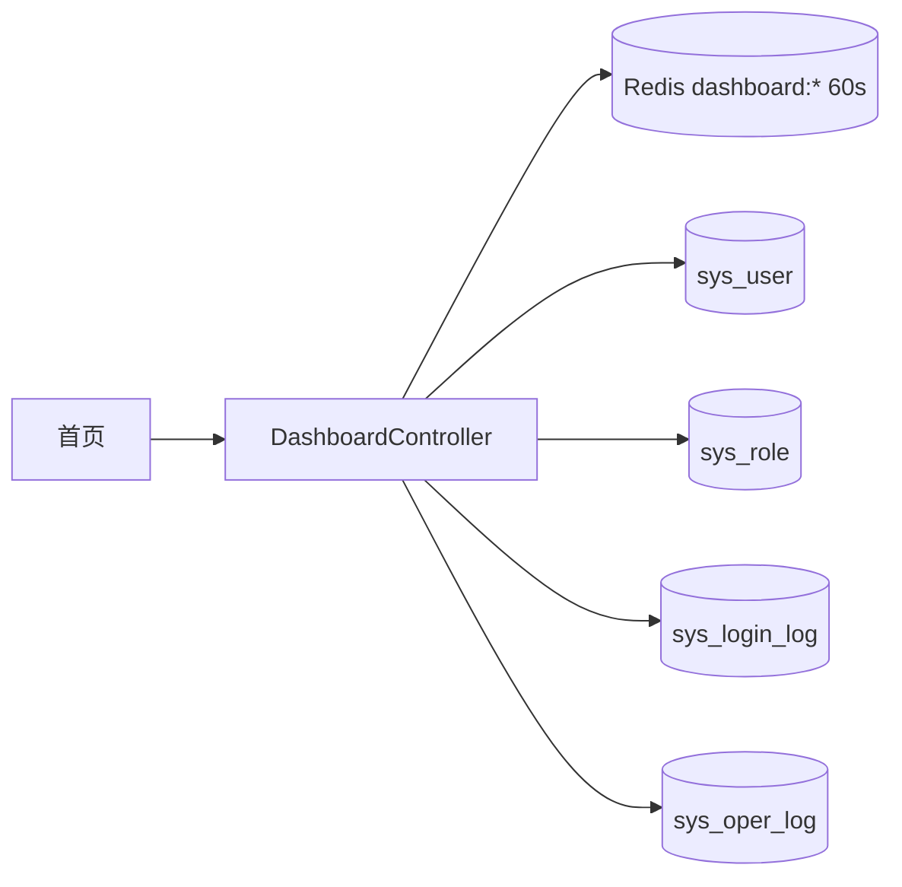

# 首页仪表盘 - 技术设计

## 概述
`DashboardModule` 提供 3 个只读接口，统计结果在 Redis 中缓存 60 秒。前端使用 ECharts 绘制折线图。

## 架构 / 流程

## 数据模型
没有新增表。统计 SQL：
- 用户总数：`COUNT(*) FROM sys_user WHERE deleted_at IS NULL`
- 今日登录人数：`COUNT(DISTINCT username) FROM sys_login_log WHERE success = 1 AND login_at >= 今日 00:00`
- 今日操作次数：`COUNT(*) FROM sys_oper_log WHERE oper_at >= 今日 00:00`
- 启用的角色数：`COUNT(*) FROM sys_role WHERE status = 1 AND deleted_at IS NULL`
- 登录趋势：`SELECT DATE(login_at) d, COUNT(DISTINCT username) FROM sys_login_log WHERE success = 1 AND login_at >= 6 天前 00:00 GROUP BY d`，在服务端补齐缺失的日期

时区统一使用服务器配置的 `TZ`（假设为 Asia/Shanghai）。

## 接口设计
| 方法 | 路径 | 权限标识 | 说明 |
| --- | --- | --- | --- |
| GET | /api/dashboard/stats | dashboard:view | `{ userTotal, todayLoginUsers, todayOperations, activeRoles }` |
| GET | /api/dashboard/login-trend | dashboard:view | `[{ date: "2026-10-23", count: 12 }, ...]`，固定 7 项 |
| GET | /api/dashboard/recent-operations | dashboard:view | 最近 10 条操作日志摘要 |

## 前端 / 交互
- `views/dashboard/index.vue`：顶部 4 个统计卡片（骨架屏加载），中部折线图，底部最近操作表格。
- 图表组件 `LineChart.vue`：按需引入 ECharts 模块以控制体积，窗口尺寸变化时自适应。
- 没有 `dashboard:view` 权限时只显示欢迎语与当前时间。
- 种子数据：把首页菜单和 `dashboard:view` 按钮权限授予系统管理员角色。

## 异常处理
- 三个接口相互独立，前端并行请求，任一失败只影响对应区块（显示"加载失败，点击重试"）。

## 测试策略
- 单测：趋势补齐缺失的日期、跨天边界。
- e2e：构造登录日志和操作日志数据，校验统计数值。
- 前端：无权限时不发起统计请求。
